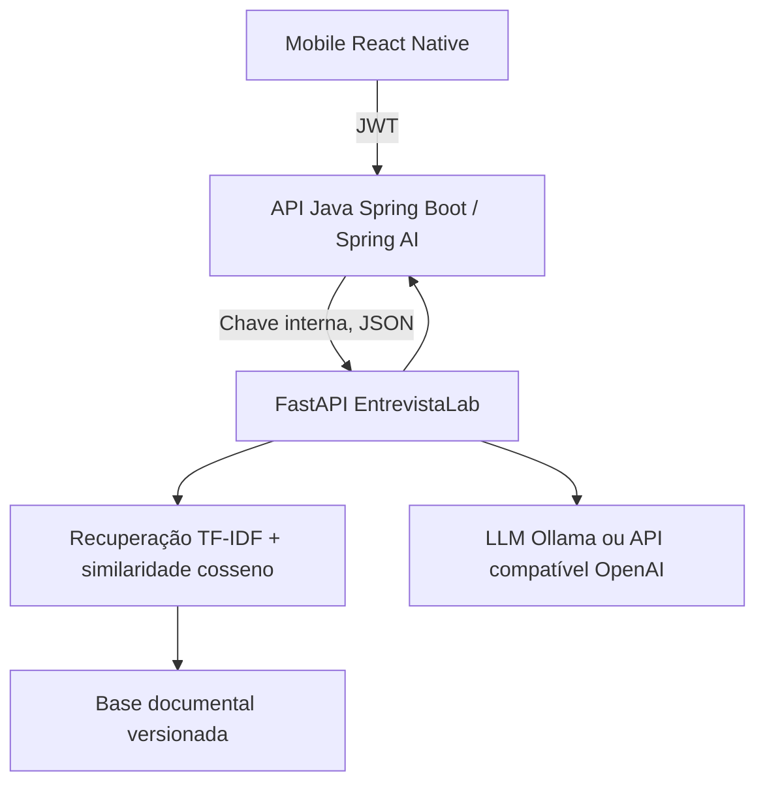

# Arquitetura proposta

**Estado atual:** somente serviço Python implementado; integração Java é um contrato de referência e exige adaptação quando o backend estiver disponível. A integração de Spring AI é responsabilidade do backend Java e não é demonstrada neste repositório.

## Dados
Base em `knowledge/base.json`: 10 documentos educativos originais, sem dados pessoais. TF-IDF de unigramas e bigramas, com remoção de acentos, indexação em memória na inicialização. Recuperação top-3 por similaridade cosseno; limiar 0,035. Sem embeddings neurais: é RAG lexical básico, não busca semântica profunda. Reindexa ao reiniciar o serviço. Retornos incluem IDs, títulos e scores. O prompt instrui o LLM a citar os IDs; **não há verificação automática de que as citações textuais são corretas**.

## Segurança e limites
Chave interna no header; em produção use HTTPS, JWT entre serviços ou mTLS, rate limiting, gestão de segredos, consentimento e política de retenção. O endpoint /health é público. A sanitização de CPF, telefone e email é parcial e não equivale a anonimização; não enviar dados sensíveis. Sem armazenamento de histórico nesta API. O serviço não decide contratação.
